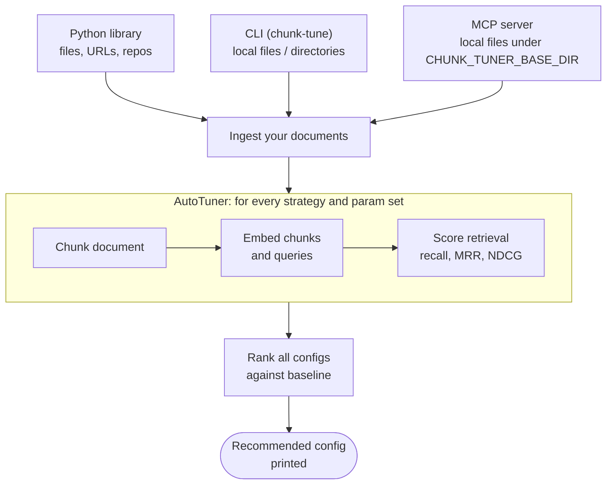

# chunktuner

[](https://pypi.org/project/chunktuner/)
[](https://pypi.org/project/chunktuner/)
[](LICENSE)
[](https://github.com/shantanu-deshmukh/chunktuner/actions/workflows/ci.yml)
[](https://shantanu-deshmukh.github.io/chunktuner/)

Auto chunking tuner and MCP server for RAG pipelines.

**Give it your documents.** It tries multiple chunking strategies, measures which setup supports retrieval best, and recommends a configuration for your corpus and use case. Zero API cost to start — run `estimate` for a dry-run before any paid calls.

Full documentation: [shantanu-deshmukh.github.io/chunktuner](https://shantanu-deshmukh.github.io/chunktuner/)



---

## What it does

When building a RAG pipeline, how you split documents into chunks directly impacts retrieval quality. `chunktuner` automates the process of finding the optimal chunking strategy for your specific corpus, embedding model, and use case.

It benchmarks strategies like fixed-token windows, recursive character splitting, semantic splitting, PDF structural chunking, and AST-based code chunking — then scores each one against retrieval metrics (token recall, MRR, NDCG) over an evaluation dataset (your own question file, LLM-generated questions, or a built-in placeholder dataset). Generation metrics (RAGAS faithfulness, answer relevancy) are optional and available only through the Python API (`Evaluator(..., enable_generation_metrics=True)` with the `ragas` extra); the CLI and MCP server report retrieval metrics only.

The CLI and MCP server ingest local files and directories. URL and repository ingestion (`URLIngestor`, `RepoIngestor`) are available from the Python API.

---

## Interfaces

- **Python library** — programmatic integration into your pipeline
- **CLI** (`chunk-tune`) — human-driven tuning from the terminal
- **MCP server** — use directly from Claude Desktop or any MCP host

---

## Quickstart

```bash
# Install (pick one)
uv tool install chunktuner
pip install chunktuner

# Initialize workspace (embedding_model defaults to null — no API calls)
chunk-tune init

# See cost estimate before running anything
chunk-tune estimate ./my_docs --use-case rag_qa

# Get a recommendation (dummy embeddings by default; add --embedding-model for real ones)
chunk-tune recommend ./my_docs --use-case rag_qa
```

**Evaluation datasets.** Without a dataset flag, `evaluate` / `compare` / `recommend` use a placeholder dataset (one query per document, whose answer is the document's first 200 characters) and print a warning. For meaningful scores, use one of:

- `--dataset questions.yaml`: your own JSON/YAML file with a `queries` list (`question`, `document_id`, `answer_spans`, optional `reference_answer`). `document_id` can be the file path relative to the corpus path, an absolute path, or the file name.
- `--generate-dataset`: generate questions with the configured `llm_model`. Run `chunk-tune estimate ./my_docs --generate-dataset` first to see the cost. The command asks for confirmation unless you pass `--yes`, and caches the dataset under `cache_dir` so re-runs reuse it.

Other evaluation flags:

- `--retrieval-scope document|corpus`: which ranking feeds the score's rank metrics. The default is `document`.
- `--retrieval-mode dense|bm25|hybrid`: first-stage retrieval. `dense` (default) ranks by embeddings, `bm25` ranks lexically and makes no embedding calls, `hybrid` fuses both with reciprocal rank fusion. `bm25` and `hybrid` need the `bm25` extra.
- `--reranker <spec>`: optional second stage that reorders the top 20 first-stage chunks per query. `dummy` (free, for tests), `local` or `local:<hf-model-id>` (local cross-encoder; needs the `late` extra and downloads the model), or any other string as a LiteLLM rerank model, e.g. `cohere/rerank-english-v3.0` (paid API; the command asks for confirmation unless you pass `--yes`).
- `--no-cache`: turn off the embedding cache, which is on by default for real embedding models.
- `--top-k` has no effect on metrics. Retrieval depth is a 2000-token context budget divided by the average chunk size.

**Python API:**

```python
from pathlib import Path
from chunktuner import FileIngestor, DummyEmbeddingFunction, LiteLLMEmbeddingFunction, AutoTuner
from chunktuner import default_registry, Evaluator, ScoreCalculator

docs = FileIngestor().ingest_dir(Path("./my_docs"))

# Free/offline: use dummy embeddings for quick strategy comparison.
# Swap in LiteLLMEmbeddingFunction for real embeddings with any provider:
#   LiteLLMEmbeddingFunction("text-embedding-3-small")          # OpenAI
#   LiteLLMEmbeddingFunction("gemini/gemini-embedding-001")     # Google
#   LiteLLMEmbeddingFunction("openai/<id>", api_base="http://localhost:1234/v1")  # local
embedding_fn = DummyEmbeddingFunction()

tuner = AutoTuner(
    strategies=default_registry,
    evaluator=Evaluator(embedding_fn),
    scorer=ScoreCalculator(use_case="rag_qa"),
)
result = tuner.recommend(
    docs, use_case="rag_qa", strategies=["fixed_tokens", "recursive_character"]
)
print(result.best.config)
```

---

## Example output

The [financial example benchmark](examples/financial_analysis/README.md) prints a ranked table with the winning config and how much it beats the baseline (`chunk-tune recommend` prints the best configuration):

```
  Rank   Strategy              Params                  Score   Recall   MRR    IOU   AvgTok
 ────────────────────────────────────────────────────────────────────────────────────────
   1 ★   recursive_character   1024 chr / 154 ov        0.821    0.950  0.880  0.062      212
     2   fixed_tokens          512 tok / 51 ov           0.764    0.920  0.840  0.059      444
   ...
  Baseline  fixed_tokens  512 tok / 0 ov  →  score 0.682
  Winner beats baseline by +0.139  (+20.4%)
```

---

## Real-world example

See [examples/financial_analysis](examples/financial_analysis/README.md) for a full benchmark on S&P 500 earnings call transcripts — a corpus where separator choice and chunk size make a measurable difference in retrieval quality.

Run it offline with zero API cost:

```bash
cd examples/financial_analysis
uv sync
uv run python run_benchmark.py --fixture --num-transcripts 2
```

---

## Supported strategies

| Strategy              | Best for                              |
| --------------------- | ------------------------------------- |
| `fixed_tokens`        | Baseline; uniform token windows       |
| `recursive_character` | General prose and documentation       |
| `paragraph_group`     | Prose with clear paragraphs; groups of whole paragraphs |
| `semantic`            | Token-budget recursive splits (semchunk; no embeddings) |
| `markdown_semantic`   | Structured Markdown docs              |
| `pdf_structural`      | PDFs with layout regions and tables   |
| `structural_semantic` | PDF/DOCX with mixed layout and text   |
| `late_chunking`       | Fixed-token fallback; true late chunking not implemented (explicit only) |
| `agentic`             | High-value narrative documents (explicit only; LLM cost) |
| `code_ast`            | Code repos (Python; other languages fall back to line windows) |
| `code_window`         | Code baseline (sliding window)        |

---

## MCP server (Claude Desktop)

Python **FastMCP** (`chunk-tune-mcp`, stdio). No Node.js build. See [docs/mcp_setup.md](docs/mcp_setup.md).

Add to your `.mcp.json`:

```json
{
  "mcpServers": {
    "chunktuner": {
      "command": "uvx",
      "args": ["--from", "chunktuner[mcp]", "chunk-tune-mcp"],
      "env": {
        "CHUNK_TUNER_BASE_DIR": "/path/to/your/corpus"
      }
    }
  }
}
```

Tools available: `list_strategies`, `preview_chunks`, `evaluate_chunking`, `recommend_config`. `evaluate_chunking` and `recommend_config` accept optional `dataset_path`, `generate_dataset`, `retrieval_scope`, `retrieval_mode`, `reranker` and `use_cache` fields, and their responses include a `warnings` list. See [docs/mcp_setup.md](docs/mcp_setup.md).

---

## CLI reference

```
chunk-tune init       Bootstrap workspace config
chunk-tune analyze    Quick structural scan (no API cost)
chunk-tune estimate   Dry-run cost/token estimate
chunk-tune evaluate   Full evaluation across strategies
chunk-tune recommend  Evaluation + best config recommendation
chunk-tune compare    Side-by-side comparison of specific strategies
chunk-tune preview    Inspect how a strategy splits a document
chunk-tune cache      Manage embedding and chunk cache
```

---

## Installation options

```bash
pip install chunktuner                 # CLI + library
uv add chunktuner                      # library
uv tool install chunktuner             # global CLI
uvx --from chunktuner chunk-tune …     # ephemeral CLI (no install)

# With optional extras
pip install "chunktuner[docling]"      # PDF/DOCX support
uv add "chunktuner[docling]"           # PDF/DOCX support
uv add "chunktuner[ragas]"             # generation metrics (Python API only)
uv add "chunktuner[semantic]"          # semantic chunking
uv add "chunktuner[code]"              # AST code chunking
uv add "chunktuner[bm25]"              # BM25 / hybrid retrieval
uv add "chunktuner[late]"              # local cross-encoder reranker
uv add "chunktuner[all]"               # everything
```

---

## Contributing

See [CONTRIBUTING.md](CONTRIBUTING.md).

---

## Author

[Shantanu Deshmukh](https://shantanudeshmukh.com) — full stack developer building E2E AI applications.

[LinkedIn](https://www.linkedin.com/in/shantanud/) / [Twitter](https://twitter.com/askshantanu)
